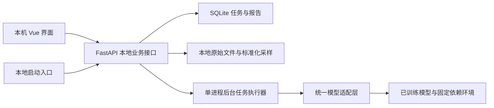

> 2026-11-10 安装进度：沿用当前前端，Windows x64 安装向导已编译并通过实际安装/升级/卸载及模型业务验收；卸载保留数据，运行中拒绝更新卸载。代码签名及全新机器离线验收仍待完成。见 [安装验收](../verification/windows-installer/验收记录.md)。

> 2026-11-10 打包进度：Windows x64 便携包已通过实际 EXE 的模型检测、报告版本、备注归档及备份恢复验证，子进程不使用系统 Python/Node。当前完成便携交付，安装向导、签名及全新电脑离线验收仍待完成。见 [Windows 运行包](Windows运行包.md)。

> 2026-11-10 实施进度：本机企业/管网/管段新增、修改、停用与三级选择已接通，服务 0.6.0、schema 4。原因及方案诊断已取消；下一步为 Windows 安装包与发布验收。详细规则见 [组织接口](本机组织管理接口.md)。

> 2026-11-09 范围修订（优先于下文历史规划）：取消具体原因与解决方案的 AI 诊断能力，删除原因推理、候选原因、置信度、解决建议及等待模型的交付要求。第四入口改为「检测报告」；保留异常检测、事件证据、历史、备注、归档、版本与 Word/PDF。旧接口字段和已保存快照仅作兼容，不启用原因能力。

# SHAD 本地后端实施计划

版本：V1.5 · 2026-11-09（M5 启动与备份基础已实现）

## 1. 本次范围调整

现在由本项目同时负责前端、本地后端和模型接入；模型提供方负责交付已经训练好的模型及其验证材料。我们不开发训练平台、不重新训练模型、不用示例规则替代推理。软件继续在用户电脑运行，不建设云端服务。

已完成 **M2 后台检测业务**：任务先保存再执行，单队列运行真实模型，固定来源快照和幂等键，原子保存逐点结果与确认事件，支持状态/历史/分页、失败重试和重启恢复。现有前端已真实完成“上传 → 创建检测 → 曲线/事件 → 临时证据报告及 Word/PDF”流程。M0/M1 保持可用。M3 现已完成报告快照、备注、归档、版本和 Word/PDF 闭环；原因模型和安装包继续后续阶段，见 [报告接口](本地报告接口说明.md) 和 [M3 验收](../verification/backend-m3/验收记录.md)。详情见 [检测任务接口](本地检测任务接口说明.md) 及 [M2 验收](../verification/backend-m2/验收记录.md)。

现有前端页面、图标、按钮和图表设计保持原样。已完成的前端 `/api` 契约继续使用；新增低层模型接口是给集成验证及后续任务执行器使用的，并不替代前端的 `/detections` 业务任务。

复核结论：**实施路线可行，但不能直接将最低八字段接口当作完整模型能力已接入。** M1/M2 已补齐可选测点、采样周期兼容性、传感器质量门控和 5000 点限制；这些不等同于模型现场准确率已验证。依据、实际产物配置及合成数据核查见 [模型对照复核](模型对照复核.md)。

## 2. 最终运行结构

- Python 3.12 + FastAPI + Uvicorn；后端固定监听 `127.0.0.1`，默认端口 8765。
- SQLite 保存元数据、任务状态、来源快照、幂等记录、事件和报告。原始 CSV 放入受管理目录；M1 标准化采样按行保存在 SQLite 并建立时间索引，M2 任务、结果和逐点/事件也按行保存在 SQLite，结果带时间索引。首版单任务最多 5000 点。数据库保存文件引用和校验值。
- 首期只有一个模型执行进程和一个队列，不引入 Redis、Celery 或云数据库。界面关闭不影响服务进程执行；整个软件退出则按任务恢复规则处理。
- 正式运行由后端同源提供 `dist`，无需 Node.js 或联网字体。开发时沿用 Vite `/api` 代理。
- 模型依赖按产物锁定。现有 `M1_s7.pkl` 记录 scikit-learn 1.9.1，已建立独立环境验证；其他产物如要求不兼容版本，应独立模型进程隔离，不在同一环境强行混装。

## 3. 阶段、产出与验收

按下列依赖顺序执行，每个完成的开发轮次独立 commit。工作量是单人开发的初步估计，不包含等待模型交付、真实数据核验和硬件环境问题。

| 阶段 | 状态 | 主要工作及交付 | 验收门槛 | 预估工作量 |
|---|---|---|---|---|
| M0 模型接入基础 | 已完成 | 服务入口；注册表；`runtime/stations/models`；同步 `model-inferences`；校验、错误、日志和测试 | 同一输入与直接 `model.detect()` 逐点一致；不训练；不越站加载；不伪造原因 | 本轮 |
| M1 本地数据层 | 已完成 | SQLite 迁移；组织与站点登记；CSV 导入、核心及可选字段映射、标准化、采样周期与传感器质量报告、分页采样 | 导入后重启可读；单位/时区/周期正确；可用可选测点不丢失；前端可浏览本站采样 | 3–4 天 |
| M2 后台检测业务 | 已完成 | 检测创建、排队、状态、重试、结果/事件；幂等和断电恢复 | 刷新不重复检测；重启不丢完成结果；连续块重置计数；结果与模型一致 | 2–3 天 |
| M3 报告持久化 | 已完成 | 报告快照、备注、历史、归档、版本；接通现有 Word/PDF | 导出与保存快照相同；归档锁定备注；并发修订冲突明确 | 1–2 天 |
| M4 具体原因诊断 | 用户已取消 | 不开发具体原因推理及解决方案生成 | 检测报告独立交付 | 不纳入计划 |
| M5 软件集成与发布 | 进行中，启动/停止及备份恢复已完成 | 实际前后端闭环；启动停止；安装包；数据路径、升级与备份恢复 | 新 Windows 电脑离线运行；无需开发环境；真实数据通过验收 | 2–3 天 |

不等待 M4 就能交付“本地数据监测、真实异常检测、异常检测报告”软件。保留 AI诊断导航，但原因能力未启用时明确提示，不能以展示效果冒充模型能力。

## 4. M0：已完成模型接口及当前状态

实现位置：`backend/`。详细请求、响应和启动操作见 [模型接口说明](模型接口说明.md)。

| 接口 | 当前用途 | 当前边界 |
|---|---|---|
| `GET /api/runtime` | 告知版本和实际能力 | 当前 `dataImport/anomalyDetection/offlineDetection=true`；reportPersistence=true、causeDiagnosis=false；`modelInterface.available=true` |
| `GET /api/stations` | 查询管理员注册的站点，支持管段筛选与分页 | M1 已加入站点新增和持久化；界面可登记，暂不提供修改/删除 |
| `GET /api/models` | 查询已登记模型、版本、校验值及真实参数 | 不允许浏览器上传 pickle 或传任意文件路径 |
| `POST /api/model-inferences` | 标准化八核心及已声明可选测点 → 实际模型 → 分数/确认区间 | 同步、最多 5000 点/5 MiB；不创建历史任务、不存档 |
| `GET /api/openapi.json` | 机器可读接口定义 | 标准 OpenAPI JSON，不套业务 data 包装；不依赖在线文档 CDN |

M1/M2 已提供真实站点、数据集及检测历史，支持检测写入/详情/结果；报告现已提供实际持久化接口；原因诊断仍返回兼容空历史，其写入/详情返回 CAPABILITY_UNAVAILABLE，不生成假原因。

M1 已补齐六个可选温度测点的白名单、映射、保存及直接推理透传，并与实际模型直接调用对照；仍兼容八核心字段。缺少可选字段会提示，模型使用已保存训练补值参数。传感器质量门控发生在导入阶段，低层同步接口仍要求调用者提供经过验证的标准化输入。

现有产物只能做“换热站状态偏离正常水平”的数值异常检测。`cause`、`solution`、`affectedMetrics` 无依据时均为空。`health` 是模型公式输出的健康指标，不是故障概率或诊断置信度。

## 5. M1：已完成本地存储与数据导入

### 5.1 表结构与约束

| 表/集合 | 主要内容及约束 |
|---|---|
| `schema_migrations` | 单调递增数据库版本；启动时事务迁移 |
| `enterprises/networks/segments` | 稳定 ID；层级外键；首批对齐前端组织 ID，不导入演示采样与演示原因 |
| `stations` | 管段绑定、名称、编码和 IANA 时区；同企业 code 唯一 |
| `models` | `(id, version)` 唯一；站点、适配器、路径、checksum、依赖与元数据快照；不可原地覆盖 |
| `datasets` | 已实现：站点、版本、原文件引用、checksum、映射、单位、质量/采样报告；不可原地修改 |
| `dataset_samples` | 已实现：数据集 ID、序号、UTC 微秒时间索引、原时区时间、数值和质量标记 |
| `detections` | 来源外键及不可变快照、范围、状态、阶段、错误、retryOf |
| `results/events` | 检测 ID、文件引用、摘要、稳定事件 ID、连续块和边界 |
| `idempotency_keys` | `(operation, key)` 唯一；请求摘要、资源 ID；同键异内容 409 |
| `diagnoses` | 来源检测、所选事件 ID、结构化证据步骤、原因/建议和能力版本 |
| `reports` | 系列 ID、版本、revision、来源快照、备注、归档时间；同系列版本唯一 |

已实现 schema v1–v3、外键、WAL 和 5 秒 busy_timeout。M1 仅创建组织/站点/模型/数据集/采样表；检测及后续表在对应阶段迁移。导入使用不可覆盖的 UUID 文件，写完并 fsync 后在同一数据库事务保存元数据和采样；失败回滚并清理本次文件，启动只清理超过 24 小时且无数据库引用的服务自有 UUID CSV，不清理用户命名或符号链接文件。M2 已通过同一事务保存结果、逐点、事件并更新 success。

### 5.2 导入流程

1. 实现 `POST /stations`，验证企业→管网→管段关系与编码唯一性。模型仍由管理员登记，禁止用户随意绑定不适用的模型。
2. 接收 multipart：CSV 文件和 manifest。独立校验 20 MiB 上限、UTF-8/BOM、分隔符、表头、列数、时间列、八核心字段及受支持可选测点的映射和原始单位。至少保留回水温度设定值、生活热水供水温度/设定值、储水箱上下部温度/上部设定值，用于实际模型中的 err_return、err_dhw、err_storage_upper、storage_delta；没有这些测点才按训练均值补值，不能导入时主动丢弃已有值。
3. 温度 degC、功率 W/kW/MW 转 kW、流量 m³/h/L/h 转 L/h；不将累计能量 kWh 当成功率。
4. 按站点时区解释时间；保留原文件。记录无效时间、重复时间和数值问题；相同时间保留第一行。
5. 30 分钟均值，区间左闭右开、标记左端；不跨缺口插值。丢弃全空 bin，保留 null 与质量标记。
6. 核心列缺失、全空、无有效点或超过质量门槛时保留 invalid 数据集及可读问题，阻止创建检测。
7. 保存 sourceChecksum、preprocessingVersion 和完整转换记录；提供数据集详情、按时间/字段筛选及真实分页采样。
8. 已记录来源间隔中位数、期望/实际半小时 bin 数、覆盖率、连续块数量和最长块。模型相关的 cThr 短块提示已在 M2 按选定模型校验。仅有小时级采样且无经过模型提供方验证的升采样策略时，可保存并查看数据，但标记不兼容当前半小时持续性模型，阻止正式检测；不得补空半小时后删空行，再把永远无法累计确认解释成正常。
9. 将传感器体检列为独立质量结果：参考 `ml/src/quality.py`，记录缺失、越界、常值/冻结、低分辨率和尖峰，以及检查窗口是否充分。短窗口不能简单按不同取值少而判坏；设定值长期不变、夏季零负荷不能误判为传感器故障。对已可靠判定且影响自适应阈值的室外测点故障，首版阻断该模型的正式检测并提示核查。

导入质量策略与模型补值不是同一件事。模型已有训练均值补值不能掩盖大量无效输入。

`StationModel.detect()` 当前未调用 `quality.py`，不能宣称已有“坏室外传感器自动回退全局阈值”。也不能在已训练的 MLP 上直接删除特征后继续使用旧权重。需要降级运行时，应由模型提供方交付经过验证的降级产物/策略，以独立模型版本或执行策略快照登记，再重新验证。

## 6. M2：已完成检测任务接口与状态机

继续采用 [本机接口约定](本机接口约定.md) 的路径和前端类型，**不要求前端改为直接调用同步模型接口**。

1. `POST /detections`：验证输入范围、站点/数据集/模型版本/时区匹配；固定来源快照和幂等记录后，事务创建 queued 并返回 202。
2. 单任务执行器依次执行 `validating → detecting → saving`，不伪造百分比；复用 M0 的校验与适配逻辑，复用 M1 已补齐的可选测点支持。首版单任务最多 5000 个标准化采样点（连续半小时采样约 104 天）；更多点的范围在创建前明确提示缩小范围，不得为绕过上限而盲目拆成多个独立推理请求。
3. 对范围内连续块分别推理，缺口重置 criticality；生成稳定事件 ID，保存逐点与事件结果；无事件仍成功。
4. 实现任务列表、详情、result、points、events 与分页/范围筛选。成功以前结果返回 `RESULT_NOT_READY`。
5. 失败记录 error.code/message/retryable；`POST /detections/{id}/retry` 新建任务并保留 retryOf，原任务与原配置不覆盖。
6. 重启恢复：queued 重新排队；遗留 running 标记 `TASK_INTERRUPTED` 并允许明确重试；已完成任务原样可读。
7. 前端关闭/刷新不取消任务。用户超时后先按已持有任务 ID 或幂等键查询，不能默认重建。
8. M1 导入与读取验收后独立开启 `dataImport`；M2 的实际任务和离线闭环验收后再开启 `anomalyDetection/offlineDetection`。原因与报告能力分别验收后开启。
9. 明确首版为区间批次检测：每个选定连续块从 criticality=0 开始，不承诺跨任务累计，也不把区间开头的上下文不足隐藏掉。块长不足 cThr 时提示“证据不足以确认持续异常”；无确认事件不能直接解释为状态正常。实时连续检测另需保存滚动上下文和计数，不能反复调用当前无状态 detect() 冒充流式模型。

同步接口没有历史、幂等和任务恢复语义；M2 已在独立业务层补齐这些保证，前端不直接改用同步接口。schema v2 新增 detections、idempotency_keys、detection_results、detection_points、detection_events；使用数据目录独占锁，拒绝两个服务同时恢复和执行同一数据库的任务。

本次核查的 60 点样例直接整段推理时，第 31 点 criticality=31；拆成两段各自执行时该点变为 1，部分分数也变化。因此以后增加分批执行必须经过状态/特征上下文与阈值语义的等价验证，不能只延长 HTTP 超时或拼接结果。

## 7. M3 已完成报告与 M4 待接入原因诊断

M3 已实现，报告不依赖原因模型。schema v3 新增 reports、report_submissions；历史按摘要分页，详情包含完整证据。创建和新版本通过持久化 Idempotency-Key 去重，版本同系列递增；2000 字备注采用乐观锁，归档和存储失败有明确恢复入口。创建报告校验所有事件属于同一成功检测，保存检测、全部逐点、所选事件及可选原因结果的独立快照。备注通过 expectedRevision 更新，冲突返回 409。归档后锁定旧版本，重新生成新版本，不覆盖历史。现有前端继续负责 Word/PDF 文件生成，共享同一快照，不另做重复的后端排版引擎。

原因模型需要单独的模型产物或可验证服务契约。只接入训练好的模型，不开发训练功能。输入应包含所选事件、关联采样和对象信息；输出应给出带证据的候选原因、核查动作、具体建议、适用局限以及可以公开展示的分析阶段。图文过程采用可核查的摘要和曲线证据；不要求模型泄露内部思维链，也不生成虚构的“深度思考”过程。

现有 `M1_s7.pkl` 不满足具体原因诊断要求，`causeDiagnosis` 保持 false；模型供应方未交付此能力时必须作为未完成项保留。

仓库虽有监督学习训练脚本和评估报告，但当前实际提交的可部署模型仅有 `ml/models/M1_s7.pkl`。`run_supervised.py` 最终保存的是二分类产物，故障类型实验不是可用的原因解释/方案生成接口；不能据此跳过原因模型交付。

## 8. 向模型提供方索取的交付包

这些是发布本站真实功能所需的产物资料，不需要用户重复填写仓库已有的八字段定义。

| 交付项 | 要求 |
|---|---|
| 已训练产物 | 本站模型文件、稳定版本、SHA-256、实际适用站点；不只给训练脚本 |
| 依赖环境 | Python、numpy/pandas/scikit-learn 版本；ONNX/Torch 等后续格式提供对应运行时和入口 |
| 输入约定 | 字段、单位、采样周期、时区、缺失处理、训练预处理版本与必要上下文 |
| 模型配置 | 实际阈值、自适应方式、cThr、scoreKind 和特征清单；不可由前端随意覆盖 |
| 验证数据 | 有事件/无事件的小样本、预期逐点结果及事件边界，用于回归；明确是否为真实现场数据 |
| 原因模型（如有） | 独立输入输出结构、原因标签、证据与建议范围、置信度定义及验证依据 |

示例产物可以验证代码接通，不能替代国内站点验证；没有本站产物时可以完成软件通路，但不能宣称本站检测模型已验证。

实际示例配置经加载确认为：M1/站 7、phys2、30 个训练特征、Mahalanobis 分数、cyclic=true、adaptive=true、cThr=11、quantile=0.99。以产物值为准，不能把模型卡示例调用中的 cThr=7 或其他厂商配置写死。推理阶段的自适应阈值是按已保存分箱查表，不会用新上传数据重新标定模型或学习本站阈值；本站标定仍由模型提供方在交付前完成。

## 9. 发布前验收清单

- 模型：与直接调用逐点对照，浮点有容差，计数/布尔/时间严格一致；已确认样本事件边界相同。
- 数据：单位转换、时区、重复/缺失/越界、连续缺口、全空和大文件覆盖；不以模型补值掩盖质量错误。
- 完整输入：同一数据的“八字段”和“含可选字段”分别对照直接调用，不以最低输入一致性代替完整测点一致性；小时级输入和短块须有明确的模型适用性提示。
- 执行策略：超过 5000 点的范围明确拒绝；未经等价验证不独立分批；传感器质量结论与实际阻断/降级策略一致。
- 任务：重复提交、同键异内容、运行失败、重启、中途退出和保存失败覆盖；状态与落盘结果一致。
- 来源：跨站/跨版本/跨任务选择被拒绝；模型和报告旧版本保持可追溯。
- 报告：备注修订冲突、归档锁定、新版本、完整历史恢复；Word/PDF 中文、曲线、来源和页面一致。
- 本地软件：安装后离线启动、端口占用、中文路径、只读/磁盘不足、升级、备份恢复和停止均有明确行为。
- 前端：保留既有单元与 Playwright；增加不拦截 `/api` 的真实本机服务测试。原先模拟 API 测试不算实际模型联调。

## 10. 下一步开始的位置

M5 第一批已完成本地启动/停止/状态、用户数据目录、端口预留及冲突提示、SQLite/WAL/原 CSV 备份与校验后恢复到新目录，见 [启动与备份](本地软件启动与备份.md) 及 [验收](../verification/backend-m5-startup/验收记录.md)。下一轮继续 M5：Windows 安装打包、升级/卸载保留数据和干净电脑离线验收。M2/M3 已完成真实检测和报告闭环。M4 已按用户要求取消，保持 causeDiagnosis=false；软件发布前仍需本站真实模型和数据验收。当前启动与调用见 [数据接口](本地数据接口说明.md) 和 [检测接口](本地检测任务接口说明.md)。
